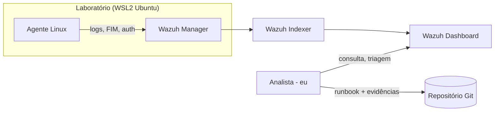

# Mini-SOC com Wazuh — Laboratório Pessoal

> **Aviso importante:** Este é um laboratório pessoal para estudo. Todos os eventos são benignos/sintéticos gerados em ambiente próprio. Não representa experiência profissional em SOC.

## Visão geral

Este projeto é um laboratório de SOC (Security Operations Center) pessoal usando Wazuh para:
- Coletar eventos de sistemas Linux e Windows
- Centralizar logs em um único painel
- Praticar triagem de alertas
- Documentar runbooks de resposta
- Construir portfólio honesto de habilidades em segurança

**Contexto:** Projeto de estudo para estudante preparando-se para Assistente de SOC/CSIRT, em paralelo com TCC sobre SAST em CI/CD.

## Arquitetura



**Ambiente:**
- WSL2 com Ubuntu no Windows
- Wazuh rodando via Docker Compose (single-node)
- Agente Linux instalado no próprio WSL2
- Agente Windows (opcional) para eventos 4624/4625/4688

## Pré-requisitos

- Windows com WSL2 instalado
- Ubuntu no WSL2
- Docker e Docker Compose (Docker Desktop)
- Mínimo de 4 vCPU, 8 GB RAM, 40 GB de disco
- Acesso à internet para download de pacotes

## Como usar

### 1. Clonar o repositório
```bash
git clone <url-do-repositorio>
cd mini-soc-wazuh
```

### 2. Configurar variáveis de ambiente
```bash
cp .env.example .env
# Editar .env com suas configurações
```

### 3. Subir o Wazuh
Siga as instruções em `docker/README.md`:
- Entrar no WSL2
- Configurar `vm.max_map_count`
- Baixar repositório Wazuh Docker
- Gerar certificados
- Subir com `docker compose up -d`

### 4. Instalar agente Linux
Siga as instruções em `docs/agente-linux.md`:
- Adicionar repositório Wazuh
- Instalar agente
- Configurar IP do manager
- Iniciar e verificar status

### 5. Acessar o Dashboard
- URL: `https://localhost`
- Credenciais padrão: verifique no `.env` do Wazuh Docker
- **IMPORTANTE:** Troque credenciais padrão imediatamente

## Scripts de coleta

### Linux (`scripts/linux/`)
- `rede_info.sh` — Informações de rede (IP, rota, DNS)
- `dns_check.sh` — Verificação DNS (A, AAAA, MX, NS)
- `http_inspect.sh` — Inspeção de requisições HTTP
- `coleta_basica.sh` — Coleta básica de sistema (processos, conexões, logins)
- `triagem_auth_log.sh` — Triagem de logs de autenticação

### Windows (`scripts/windows/`)
- `coleta_eventos.ps1` — Coleta de eventos 4624/4625/4688 via PowerShell

Todos os scripts:
- São somente leitura (não alteram o sistema)
- Salvam saída em `evidencias/`
- Têm opção `-h` para ajuda
- Usam `set -euo pipefail` (bash)

## Documentação

- `docs/ambiente-wsl2.md` — Configuração do ambiente WSL2
- `docs/agente-linux.md` — Instalação do agente Wazuh Linux
- `docs/queries.md` — Consultas e filtros úteis no Dashboard
- `docs/dashboard.md` — Como criar painéis e exportar relatórios
- `docs/windows-eventos.md` — Catálogo de eventos Windows (4624, 4625, 4688, 4720, 4740, 1102)
- `docs/wireshark.md` — Captura e análise de tráfego com Wireshark

## Runbooks

Runbooks de triagem em `runbooks/`:
- `falhas-de-login.md` — Triagem de falhas de autenticação
- `processo-suspeito.md` — Triagem de processos suspeitos
- `acesso-remoto-inesperado.md` — Triagem de acessos remotos não autorizados

Cada runbook inclui:
- Gatilho do alerta
- Contexto a verificar
- Passos de validação
- Critérios de falso positivo
- Quando escalar
- Evidências a guardar

## Geração de eventos benignos

Todos os eventos são gerados em ambiente próprio, de forma segura:

| Evento | Como gerar | O que procurar |
|---|---|---|
| Falha de login SSH | Errar senha no próprio Linux | `sshd: Failed password` no auth.log |
| Falha de logon Windows (4625) | Errar senha na VM Windows | Event ID 4625 |
| Logon bem-sucedido (4624) | Logar normalmente | Event ID 4624 |
| Novo processo (4688) | Abrir aplicação (notepad, calc) | Event ID 4688 |
| Criação de usuário (4720) | Criar/remover usuário de teste | Evento de conta criada |
| Alteração em arquivo (FIM) | Editar arquivo monitorado | Alerta de integridade |
| Arquivo EICAR | Baixar em ambiente isolado | Alerta de detecção (se módulo ativo) |

**Regra:** Anotar hora exata de cada evento para localizar no Dashboard.

## Como triar um alerta

1. **Identificar:** qual regra disparou, nível, agente, horário
2. **Contexto:** ativo é meu? usuário esperado? horário normal?
3. **Correlacionar:** há eventos antes/depois? (ex: falhas seguidas de sucesso)
4. **Decidir:** falso positivo, benigno esperado, suspeito ou incidente
5. **Documentar:** fatos, fontes, consultas, hipóteses, limitações
6. **Escalar?** Se sim, para quem e com quais evidências

**Lembre:**
- Evento isolado não comprova ataque
- Alerta não é incidente
- Falso positivo é comum em laboratórios

## Limitações

- Apenas um agente Linux (escala limitada)
- Eventos sintéticos/benignos (sem ataques reais)
- Ambiente isolado (sem tráfego real de produção)
- Sem correlação com SIEM corporativo ou threat intelligence
- Sem automação de resposta (somente detecção e triagem manual)

## Segurança do laboratório

**Checklist antes de cada commit:**
- [ ] Não há senhas, tokens, chaves ou IPs reais no diff
- [ ] Capturas de tela não mostram dados sensíveis
- [ ] `.env`, certificados e arquivos grandes estão no `.gitignore`
- [ ] Dashboard do Wazuh **não** está exposto na internet
- [ ] Todas as atividades foram feitas somente em ambiente próprio

## Estrutura do repositório

```
mini-soc-wazuh/
├── PROJECT.md                 # Este guia de vibe coding
├── README.md                  # Este arquivo
├── .env.example               # Variáveis de ambiente (sem segredos)
├── .gitignore                 # Ignora arquivos sensíveis
├── docker/
│   └── README.md              # Como subir o Wazuh
├── scripts/
│   ├── linux/                 # Scripts de coleta Linux
│   └── windows/               # Scripts de coleta Windows
├── pcap/                      # Capturas sintéticas
├── docs/                      # Documentação técnica
├── runbooks/                  # Runbooks de triagem
└── evidencias/                # Saídas dos scripts e capturas
```

## Como apresentar este projeto

> "Montei um mini-SOC de laboratório com Wazuh em ambiente próprio, geri eventos benignos, pratiquei triagem e documentei runbooks. É um projeto de estudo, não experiência profissional."

**Evite:**
- Afirmar que "operou um SOC"
- Dizer que "respondeu incidentes reais"
- Dizer que "detectou ataques"
- Exagerar habilidades ou experiência

**Seja honesto:**
- É um laboratório pessoal
- Eventos são sintéticos
- Foco em aprendizado e prática
- Não há experiência profissional em SOC

## Próximos passos

- [ ] Subir o Wazuh e conectar agente Linux
- [ ] Gerar pelo menos 3 eventos benignos
- [ ] Localizar os eventos no Dashboard
- [ ] Praticar triagem de cada evento
- [ ] Criar runbooks para os cenários praticados
- [ ] Montar dashboard com visualizações úteis
- [ ] Exportar relatório sem dados sensíveis
- [ ] Documentar aprendizados e limitações

## Recursos

- [Documentação oficial Wazuh](https://documentation.wazuh.com/)
- [Repositório Wazuh Docker](https://github.com/wazuh/wazuh-docker)
- [Wazuh Community](https://wazuh.com/community/)

## Licença

Este projeto é para fins educacionais. Sinta-se livre para usar como referência para seu próprio laboratório de estudo.

---

**Última atualização:** Outubro 2026
**Versão Wazuh:** 4.14.9
